# EVIDENCIA DE APRENDIZAJE: SISTEMA DE REGISTRO Y PROCESAMIENTO DE CALIFICACIONES
**Servicio Nacional de Aprendizaje (SENA)**  
*Centro de Formación en Tecnologías de la Información y las Comunicaciones*  
*Programa de Formación: Análisis y Desarrollo de Software*

---

| INFORMACIÓN GENERAL | DETALLE |
| :--- | :--- |
| **Reto Principal:** | Sistema de registro y procesamiento de calificaciones |
| **Aprendiz:** | Jayzir Martinez |
| **Modalidad:** | Individual |
| **Repositorio GitHub:** | [https://github.com/JayzirTech/Sena/tree/main/sistema_calificaciones](https://github.com/JayzirTech/Sena/tree/main/sistema_calificaciones) |
| **Tecnologías:** | Algoritmia, Pseudocódigo, Python 3.12 (Clean Architecture), Persistencia CSV |
| **Fecha:** | 17 de noviembre de 2026 |

---

## 1. Comprensión de la Situación Problema

Una institución educativa requiere un sistema de información y procesamiento algorítmico que permita:
1. Registrar de forma dinámica e ilimitada las calificaciones de varios aprendices en un salón de clases.
2. Calcular el promedio de cada aprendiz a través de sus asignaturas y periodos lectivos.
3. Determinar de forma automática el estado de aprobación individual evaluando si el promedio obtenido es **mayor o igual a 70 puntos** ($\ge 70.0$).
4. Consolidar y presentar al final de la ejecución el **promedio general del grupo**, junto con el consolidado estadístico del salón.

---

## 2. Descomposición del Problema (Entradas, Procesos y Salidas)

```mermaid
flowchart LR
    subgraph ENTRADAS
        E1[Documento y Nombre del Aprendiz]
        E2[Selección de Asignatura]
        E3[Periodo Académico 1 a 4]
        E4[Calificación Numérica 0 a 100]
    end

    subgraph PROCESOS
        P1[Autogeneración de ID y Correo]
        P2[Cálculo de Promedios por Periodo]
        P3[Definitiva Anual: Suma Periodos / 4]
        P4[Promedio General del Aprendiz]
        P5[Estructura Condicional: Promedio >= 70]
        P6[Acumulación y Promedio del Salón]
    end

    subgraph SALIDAS
        S1[Boletín Individual por Aprendiz]
        S2[Resumen Detallado por Materia]
        S3[Consolidado General del Salón]
        S4[Promedio General del Grupo]
    end

    ENTRADAS --> PROCESOS --> SALIDAS
```



### 2.1. Datos de Entrada (Inputs)
*   **Identificación del Aprendiz:** Documento de identidad real (CC/TI) y nombres completos.
*   **Información Académica:** Asignatura evaluada (Matemáticas, Literatura, Ciencias Sociales, Química, Programación de Software).
*   **Periodo Lectivo:** Número entero del $1$ al $4$.
*   **Calificación:** Valor decimal entre $0.0$ y $100.0$. Sin límite de notas ingresadas por periodo.

### 2.2. Procesos y Fórmulas de Negocio (Logic)
1.  **Autogeneración de Identificadores:** Asignación secuencial (`EST-0001`) y generación de correo institucional normalizado (`nombre.apellido@sena.edu.co`) con control anti-colisión.
2.  **Promedio del Periodo:**
    $$\bar{x}_{\text{periodo}} = \frac{\sum \text{notas del periodo}}{k}$$
3.  **Definitiva Anual de Asignatura (División Estricta entre 4):**
    $$\text{Definitiva}_{\text{materia}} = \frac{P_1 + P_2 + P_3 + P_4}{4.0}$$
    *(Los periodos sin notas computan con $0.0$).*
4.  **Promedio General del Aprendiz en el Salón:**
    $$\bar{X}_{\text{aprendiz}} = \frac{\sum_{m=1}^{5} \text{Definitiva}_m}{5.0}$$
5.  **Evaluación Condicional de Aprobación:**
    $$\text{Estado} = \begin{cases} \text{APROBADO}, & \text{si } \bar{X}_{\text{aprendiz}} \ge 70.0 \\ \text{NO APROBADO}, & \text{si } \bar{X}_{\text{aprendiz}} < 70.0 \end{cases}$$
6.  **Promedio General del Grupo (Métrica Global):**
    $$\bar{X}_{\text{salón}} = \frac{\sum_{e=1}^{N} \bar{X}_{e}}{N}$$

### 2.3. Resultados Esperados (Outputs)
*   Ficha individual de confirmación por aprendiz registrado.
*   Boletín académico individual con desglose por periodos, definitiva, materias a reforzar y estado.
*   Sábana consolidada del salón con las definitivas de cada estudiante, lista de aprobados/reprobados y el **promedio general del salón**.

---

## 3. Definición de Variables y Estructuras de Datos

| Variable / Estructura | Tipo de Dato | Rol Algorítmico | Propósito |
| :--- | :--- | :--- | :--- |
| `id_estudiante` | Texto | Clave Primaria / ID | Código único autogenerado (`EST-0001`). |
| `documento` | Texto | Identificador Legal | Cédula o Tarjeta de Identidad del aprendiz. |
| `nombre_completo` | Texto | Atributo | Nombres y apellidos del aprendiz. |
| `correo` | Texto | Atributo | Correo institucional autogenerado. |
| `estado` | Texto | Control | `ACTIVO` o `INACTIVO` (soporte de borrado lógico). |
| `periodo` | Entero | Control temporal | Periodo lectivo evaluado ($1, 2, 3, 4$). |
| `nota` | Real (Float) | Entrada | Calificación numérica ($0.0 \le \text{nota} \le 100.0$). |
| `sumaNotasPeriodo` | Real (Float) | Acumulador | Suma de notas del estudiante en un periodo específico. |
| `cantNotasPeriodo` | Entero | Contador | Número de calificaciones asentadas en el periodo. |
| `definitivaMateria`| Real (Float) | Variable de cálculo | Promedio anual de la asignatura ($\sum P_i / 4.0$). |
| `promedioGeneral` | Real (Float) | Variable de cálculo | Promedio anual acumulado del aprendiz en las 5 materias. |
| `sumaPromediosSalon`| Real (Float)| Acumulador global | Suma de los promedios de todos los aprendices del salón. |
| `totalAprendices` | Entero | Contador global | Cantidad total de aprendices evaluados en el grupo. |
| `promedioGeneralGrupo`| Real (Float)| Métrica final | Media aritmética global del salón. |

---

## 4. Estructuras de Datos y Arreglos Utilizados

Para garantizar capacidad ilimitada y ordenamiento analítico, la información se organiza en arreglos y estructuras tabulares:

1.  **Arreglo/Vector de Calificaciones del Periodo:** Almacena la colección dinámica de notas de un aprendiz en una asignatura y periodo sin tope máximo.
2.  **Arreglo de Definitivas por Asignatura:** Vector de 5 posiciones que almacena la nota final de Matemáticas, Literatura, Ciencias Sociales, Química y Programación.
3.  **Persistencia en Archivos Planos (Modelo Relacional Desacoplado):**
    *   `data/estudiantes.csv`: Dimensión de aprendices con bandera de borrado lógico.
    *   `data/calificaciones.csv`: Historial transaccional con llaves foráneas y periodo.

---

## 5. Diseño del Algoritmo en Pseudocódigo (Estándar PSeInt)

```pascal
Algoritmo SistemaRegistroCalificaciones
    // Definición de variables principales
    Definir numAprendices, i, j, cantNotas Como Entero
    Definir nombre Como Cadena
    Definir nota, sumaNotas, promPeriodo Como Real
    Definir definitivaMateria, sumaDefinitivas, promAprendiz Como Real
    Definir sumaPromediosGrupo, promedioGeneralGrupo Como Real
    Definir estado Como Cadena

    sumaPromediosGrupo <- 0.0

    Escribir "=========================================================="
    Escribir "   SISTEMA DE REGISTRO Y PROCESAMIENTO DE CALIFICACIONES   "
    Escribir "=========================================================="
    Escribir "¿Cuántos aprendices desea procesar en el grupo?: "
    Leer numAprendices

    // Ciclo principal para procesar a cada aprendiz del salón
    Para i <- 1 Hasta numAprendices Con Paso 1 Hacer
        Escribir ""
        Escribir "------------------------------------------------------"
        Escribir "REGISTRO DEL APRENDIZ #", i
        Escribir "Ingrese nombre del aprendiz: "
        Leer nombre

        sumaDefinitivas <- 0.0

        // Ciclo para procesar las asignaturas del curso (ej. 5 materias)
        Para j <- 1 Hasta 5 Con Paso 1 Hacer
            Escribir ">> Asignatura ", j, ":"
            Escribir "   ¿Cuántas notas registró en el año escolar?: "
            Leer cantNotas

            sumaNotas <- 0.0
            Para k <- 1 Hasta cantNotas Con Paso 1 Hacer
                Escribir "   Ingrese calificación ", k, " (0 - 100): "
                Leer nota
                sumaNotas <- sumaNotas + nota
            FinPara

            Si cantNotas > 0 Entonces
                definitivaMateria <- sumaNotas / cantNotas
            Sino
                definitivaMateria <- 0.0
            FinSi

            sumaDefinitivas <- sumaDefinitivas + definitivaMateria
        FinPara

        // Cálculo del promedio individual del aprendiz
        promAprendiz <- sumaDefinitivas / 5.0

        // Estructura de decisión condicional: Umbral de Aprobación >= 70
        Si promAprendiz >= 70.0 Entonces
            estado <- "APROBADO"
        Sino
            estado <- "NO APROBADO"
        FinSi

        // Salida individual por aprendiz
        Escribir "RESULTADO INDIVIDUAL:"
        Escribir "Aprendiz: ", nombre
        Escribir "Promedio Final Obtenido: ", promAprendiz
        Escribir "Estado Académico: ", estado

        // Acumulación para el promedio general del grupo
        sumaPromediosGrupo <- sumaPromediosGrupo + promAprendiz
    FinPara

    // Cálculo y presentación del promedio general del grupo
    Si numAprendices > 0 Entonces
        promedioGeneralGrupo <- sumaPromediosGrupo / numAprendices
    Sino
        promedioGeneralGrupo <- 0.0
    FinSi

    Escribir ""
    Escribir "=========================================================="
    Escribir "               REPORTE CONSOLIDADO DEL GRUPO               "
    Escribir "=========================================================="
    Escribir "Total de aprendices evaluados: ", numAprendices
    Escribir "PROMEDIO GENERAL DEL GRUPO:   ", promedioGeneralGrupo
    Escribir "=========================================================="
FinAlgoritmo
```

---

## 6. Estructura de Decisión y Regla de Aprobación

El algoritmo implementa una bifurcación lógica condicional estricta:

$$\text{Si } (\bar{X}_{\text{aprendiz}} \ge 70.0) \implies \text{Estado} = \text{"APROBADO"}$$
$$\text{Si No } \implies \text{Estado} = \text{"NO APROBADO"}$$

*   **Fundamento:** Todo estudiante con una nota final de $70.0$ a $100.0$ aprueba el año escolar de forma satisfactoria. Si obtiene una nota estrictamente menor a $70.0$, el sistema lo categoriza como reprobado.

---

## 7. Pruebas de Escritorio (Desk Check)

A continuación se detalla la prueba de escritorio realizada con diferentes perfiles de aprendices para comprobar la exactitud de los cálculos matemáticos, condicionales y acumuladores:

### Matriz de Casos de Prueba

| # | Aprendiz | Doc / ID | Notas Mat. | Notas Prog. | Notas Lit. | Notas Soc. | Notas Quim. | Promedio Final | Condición ($\ge 70$) | Estado | Acumulador Salón |
| :---: | :--- | :---: | :---: | :---: | :---: | :---: | :---: | :---: | :---: | :---: | :---: |
| **1** | Ana María Gómez | `EST-0001` | 85.0 | 95.0 | 80.0 | 78.0 | 72.0 | **82.00** | $82.00 \ge 70.0$ (V) | **APROBADO** | 82.00 |
| **2** | Carlos Ramírez | `EST-0002` | 62.5 | 77.5 | 70.0 | 68.0 | 58.5 | **67.30** | $67.30 \ge 70.0$ (F) | **NO APROBADO** | 149.30 |
| **3** | Laura Restrepo | `EST-0003` | 93.5 | 99.0 | 90.0 | 92.0 | 88.0 | **92.50** | $92.50 \ge 70.0$ (V) | **APROBADO** | 241.80 |
| **4** | Juan Morales | `EST-0004` | 75.0 | 82.0 | 85.0 | 80.0 | 76.0 | **79.60** | $79.60 \ge 70.0$ (V) | **APROBADO** | 321.40 |
| **5** | Sofía Herrera | `EST-0005` | 50.0 | 65.0 | 62.0 | 60.0 | 58.0 | **59.00** | $59.00 \ge 70.0$ (F) | **NO APROBADO** | 380.40 |

### Consolidación Estadística del Grupo:
*   **Total Aprendices Evaluados ($N$):** $5$
*   **Suma Total de Promedios:** $380.40$
*   **Cálculo del Promedio General del Salón:**
    $$\bar{X}_{\text{salón}} = \frac{380.40}{5} = \mathbf{76.08}$$
*   **Aprendices Aprobados:** $3$ ($60.0\%$)
*   **Aprendices Reprobados:** $2$ ($40.0\%$)
*   **Aprendiz Destacado (Mejor Promedio):** Laura Restrepo ($92.50$)

---

## 8. Implementación del Software y Enlace al Repositorio

El diseño algorítmico fue llevado a una solución funcional completa en **Python 3.12** aplicando **Clean Architecture**, con persistencia en archivos CSV, validaciones y menú interactivo por consola.

### Instrucciones de Ejecución:
1. **Clonar el repositorio oficial:**
   ```bash
   git clone https://github.com/JayzirTech/Sena.git
   cd Sena/sistema_calificaciones
   ```
2. **Ejecutar el Portal Interactivo:**
   ```bash
   python main.py
   ```
3. **Inyectar Datos de Prueba Automatizados:**
   ```bash
   python seed.py
   ```
4. **Ejecutar Suite de Pruebas Unitarias:**
   ```bash
   python -m unittest discover tests
   ```

*Repositorio oficial en GitHub:*  
👉 **[https://github.com/JayzirTech/Sena/tree/main/sistema_calificaciones](https://github.com/JayzirTech/Sena/tree/main/sistema_calificaciones)**
